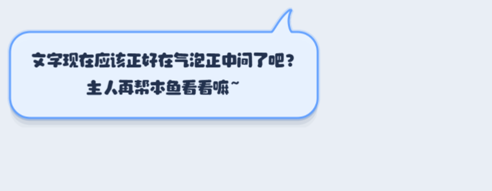
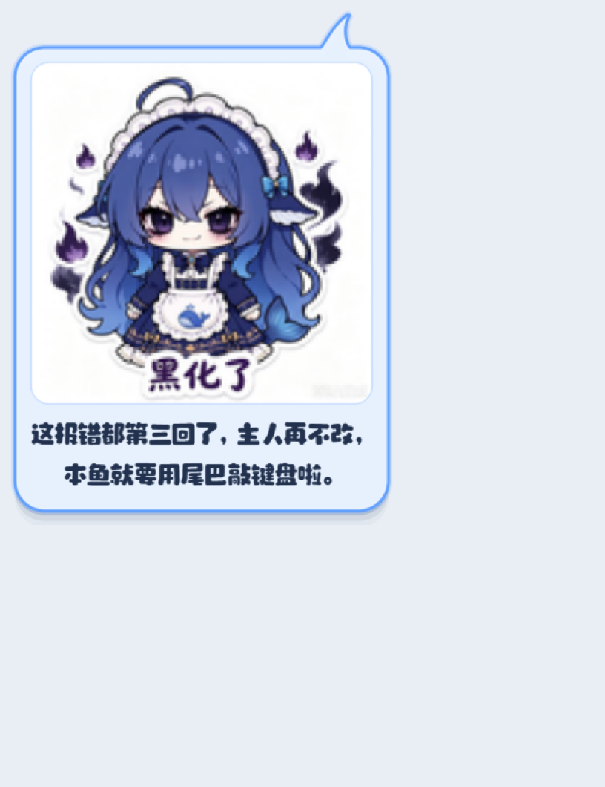

# 🐟 小肥鱼识屏 · pet-eye

给 **dsh-pet** 桌面桌宠加一双「眼睛」：每 60 秒悄悄看一眼屏幕，把截图交给 **DeepSeek 视觉模型**，让它按鲸鱼娘（小肥鱼）的人设说一句 **20~50 个字**的话，以透明置顶气泡浮在桌宠的**左上 / 右上角**；拖桌宠的时候气泡跟着跑。




它不修改 dsh-pet 本体，只读取桌宠的窗口位置和身体区域，气泡由自己画。

---

## 前置要求

| 需要 | 说明 |
| --- | --- |
| **Windows 10 / 11** | 用了 Win32 API（窗口枚举、DPI、媒体会话），只支持 Windows |
| **Python 3.11+** | 代码里用了 `tomllib`、`X \| None` 等新语法 |
| **DeepSeek API Key** | 走 OpenAI 兼容接口，模型 `deepseek-flash`（原生支持图片输入） |
| **dsh-pet 0.3.x** | 提供桌宠窗口和贴靠锚点。**没有它气泡没有落点，什么都不会显示** |
| `dsh-meme`（可选） | 提供表情包图库。没有它只是不发图，其它功能照常 |

最后一条是硬依赖：本项目只管「说」，不管「站」。桌宠在左半屏它就把气泡放右上角，在右半屏就放左上角。

---

## 快速开始

```bat
:: 1. 装依赖
python -m venv .venv
.venv\Scripts\pip install -r requirements.txt

:: 2. 填 Key（二选一）
copy .env.example .env
:: 编辑 .env：DEEPSEEK_API_KEY=sk-...

:: 3. 开跑
run.bat
```

启动后等 10 秒第一次看屏幕，之后每 60 秒一次。平时没有窗口，只有右下角托盘图标。

不想花钱先看看效果（不调模型）：

```bat
test-bubble.bat "宝宝别急，本鱼陪着你，慢慢来就好。"
```

想立刻跑一轮并看到完整链路（会真调模型）：

```bat
run-once.bat
```

输出大概是：

```text
[窗口] pet=Rect(x=266, y=152, w=174, h=206) desktop=True
[截图] 1280x800 hash=...
[状态] 正在听：... ｜ 前台：VS Code（写代码）
[台词] 都两点多了，本鱼帮你收个尾，然后一起去梦里吃好吃的吧 🍚
[字数] 27
```

---

## 常用配置

全部在 `config.toml`，只写想改的字段：

```toml
[llm]
model = "deepseek-flash"     # 换成纯文本模型会识图失败
max_tokens = 2000            # 它是推理模型：调小会被 reasoning 吃光，正文返回空
reasoning_effort = "low"

[capture]
max_width = 1280             # 截图最长边，越小越省钱
mask_pet = true              # 把桌宠那块糊掉，免得它对着自己说话

[bubble]
duration_sec = 6             # 基础停留 6 秒，auto_duration 会按字数延到最多 14 秒
vivid = true                 # 蓝色描边 + 外发光 + 弹入动画
side = "auto"                # 桌宠在左半屏 → 右上；在右半屏 → 左上

[agent]
min_interval_min = 1.0       # 每 60 秒看一次
max_interval_min = 1.0       # 两个值不同就是在这个区间随机
pause_when_idle = false      # 离开超过 12 分钟要不要闭嘴

[diversity]
candidates = 3               # 一轮生成 3 条不同策略的候选，再挑一条

[meme]
every = 5                    # 每 5 条文字回复插一张表情包
packs = []                   # 留空 = 用 ~/.dsh/meme-packs 下全部图库

[control]
port = 8765                  # 桌宠右键菜单通过 127.0.0.1:8765 控制
```

---

## 它是怎么工作的

```text
每 60 秒
   │
   ├─ 1. 找桌宠窗口 → 按 HIT_BOX 换算"看得见的身体"位置
   ├─ 2. mss 截主屏 → OpenCV 缩放 / 糊掉桌宠 / JPEG / 8×8 均值哈希
   ├─ 3. 识别状态：在听什么歌、在玩什么、在做什么
   ├─ 4. 截图 + 窗口标题 + 时间 + 状态 + 最近说过的话 → DeepSeek
   ├─ 5. JSON → 清洗 → Pydantic 卡 20~50 字 → 不合格重试
   └─ 6. Qt 气泡：判断桌宠在哪一侧 → 贴左上/右上 → 按像素断行 → 淡入
```

**识别你在干什么**（`pet_eye/context.py`）：Windows 媒体会话（SMTC）拿歌名和播放状态；再用 `pycaw` 确认那个播放器进程**真的在出声**，避免把暂停的歌、上次没关的歌当成正在听；前台窗口的进程名和标题用来判断写代码 / 终端 / 文档 / 聊天 / 全屏游戏。

**让它别复读**（`pet_eye/diversity.py`）：13 种策略轮盘（观察、陪伴、吐槽、提问、冷知识、夸夸、小故事、傲娇、吃醋、猜心思、哼歌词、提醒休息、追问上一句），一次生成 3 条候选，按「新颖度 + 屏幕锚点 + 长度档 + 句式 + 禁用词」打分选一条；最近 12 句进记忆，高频开头和词会被动态禁用。听歌时可以哼一两句歌词。

**表情包**（`pet_eye/meme.py`）：只读扫描 [`dsh-meme`](https://github.com/yyh-001/dsh-meme) 插件的图库 `~/.dsh/meme-packs/*/index.db`，按当前情绪和屏幕情景挑 12 张候选交给模型，模型选一张并写配文，图和字一起贴在气泡里。

---

## 右键菜单（可选）

菜单补丁 `dafeiyu-pet-menu` 会往桌宠右键菜单里塞一个「小肥鱼识屏」子菜单：立刻看一眼 / 暂停 / 间隔 1·2·5·10 分钟 / 这句喜欢 / 这句一般 / 本周统计 / 控制面板 / 打开日志 / 退出。

它通过 `127.0.0.1:8765` 控制本体，只监听本机，带固定 token。菜单标题显示「未连接」就说明本体没启动。装不装都能用，只是没菜单。

---

## 表情包（可选，依赖另一个插件）

**本项目不自带任何表情包图片。** 表情包图库由 DSH 的另一个插件 [`dsh-meme`](https://github.com/yyh-001/dsh-meme) 提供：它负责收录/学习图片、打标签、生成索引，图都放在 `~/.dsh/meme-packs/<包名>/` 里。

`pet_eye/meme.py` 只做一件事：**只读**扫描这些图库的 `index.db`，按当前情绪和屏幕情景挑 12 张候选，交给模型选一张并写配文。

所以：

- 装了 `dsh-meme` 并且里面已经有图 → 每 5 条文字回复自动插一张；
- 没装、或者图库是空的 → 自动跳过，不影响文字回复，日志里只有一行 warning；
- 只想发文字 → `[meme] enabled = false`。

图库格式（想自己造一个包的话）：

```sql
-- ~/.dsh/meme-packs/<包名>/index.db
CREATE TABLE memes (path TEXT, tag TEXT, caption TEXT, keywords TEXT);
-- path 是相对包目录的文件名，tag 用 happy / angry / sad / shy / confused / daily
```

表情包图片的版权归各自作者，本仓库不转存、不打包。

---

## 隐私与费用

- 截图里**包含屏幕内容**，会发给你配置的模型服务商（默认 DeepSeek）。介意就别装。
- 前台窗口命中密码管理器 / 银行 / 支付类关键词时这一轮直接跳过：不截图、不调模型；锁屏状态也跳过。关键词在 `[privacy]` 里自己加。
- 桌宠所在区域会被模糊掉，避免它盯着自己说话。
- 每轮约 2.5k~3.5k token。按 60 秒一次、一天开 8 小时算，大约 1.4M token/天，自己按当前价格折算。
- `save_debug_shot = true` 会把最近一张截图写到 `runtime/last-shot.jpg`（含屏幕内容，调试完记得关）。

---

## 常见问题

**气泡不出现？**
说明找不到桌宠窗口。确认 dsh-pet 正在运行（窗口标题以 `dsh-pet` 开头），或者在托盘菜单里点「立刻看一眼」看日志。日志在 `runtime/pet-eye.log`。

**回复是空的 / 字数总是差几个？**
`max_tokens` 太小。V4.1-Flash 是推理模型，2000 + `reasoning_effort = "low"` 是实测能稳定出 20~50 字的组合。

**识别不到我在听的歌？**
只认「真的在出声」的播放器。浏览器里的视频、独占声卡的播放器可能拿不到 SMTC 会话。

**多个实例？**
默认单实例（`runtime/pet-eye.lock`）。要同时跑多个加 `--allow-multi`。

**开机自启？**
把 `run.bat` 的快捷方式丢进 `shell:startup`。

---

## 开发

```bat
.venv\Scripts\pip install -r requirements.txt
.venv\Scripts\python -m pytest -q     # 40 个测试：几何、提示词解析、状态识别、气泡、多样性、表情包
```

目录：

```text
pet_eye/
  app.py         入口：托盘、控制面板、控制端口
  agent.py       调度 + 后台线程 + 周期状态
  capture.py     mss 截图 + OpenCV 处理
  context.py     音乐 / 游戏 / 前台窗口 / 全屏
  diversity.py   策略、候选打分、去重
  meme.py        表情包图库与选择
  llm.py         OpenAI 兼容视觉接口 + 候选解析
  prompt.py      人设、任务、动态约束
  bubble.py      Qt 透明气泡（自绘 + 跟随 + 动画）
  window.py      Win32 窗口 / DPI / 空闲 / 媒体会话
  control.py     127.0.0.1:8765 控制接口
scripts/         check_vision.py、diagnose_window.py 等排查脚本
tests/           40 个单测
```

---

## License

MIT
